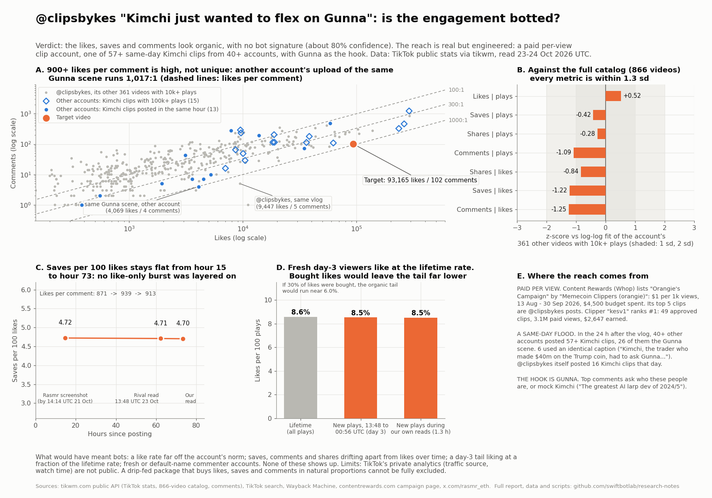

# Is the @clipsbykes Kimchi clip botted? (poidh bounty #1502)

The question ([poidh #1502](https://poidh.xyz/base/bounty/1502)): Rasmr [posted](https://x.com/rasmr_eth/status/2112910500765835379) a screenshot of a TikTok clip ("48k likes in 11 hours") as evidence that Kimchi is hugely popular on TikTok. Is the activity on [that clip](https://www.tiktok.com/@clipsbykes/video/7698896779714071830), and on the other videos from [@clipsbykes](https://www.tiktok.com/@clipsbykes), organic, or is it botted?

## Verdict

**The engagement looks organic: I found no sign of bought likes, views or comments (about 80% confidence). The reach is real, but it is engineered, so it does not show "massive organic Kimchi popularity".**

1. **The likes, saves and comments behave like a normal viral clip.** At hour 15 (Rasmr's screenshot) the clip had 4.72 saves per 100 likes. At hour 72 it had 4.70. On day 3, new viewers liked 8.5% of the new plays, almost exactly the lifetime rate of 8.6%. If likes had been bought in a burst, both ratios would have shifted.
2. **The account is a paid per-view clipper.** On Content Rewards (Whop's clipping marketplace), "Orangie's Campaign" paid $1 per 1,000 views (13 Aug to 30 Sep 2026). The campaign's top 5 clips are @clipsbykes posts. Its #1 clipper, "kesv1", earned $2,647 from 49 approved clips with 3.1M paid views.
3. **The clip is one of dozens.** The same day's Kimchi footage was clipped by at least 40 other accounts within 24 hours, 26 of them with Gunna in the caption. Six used a word-for-word identical caption. The hook is Gunna, and two of the three most-liked comments mock Kimchi.

So the numbers measure clip-farm distribution plus a celebrity cameo, not a Kimchi fanbase. That is a manipulation of perception, but it is not botting.

**Three popular arguments in other claims do not hold:**

| Claim | What the data shows |
|---|---|
| "Comments frozen at 95 while likes kept growing" | Comments reached **102** by 24 Oct 00:56 UTC. When we pulled the comments, the count of 101 was exactly 58 top-level comments + 43 replies, so nothing is hidden. It just grows slowly. |
| "900:1 likes per comment proves bought likes" | Another account's upload of the **same Gunna scene** runs **1,017:1**. A same-vlog clip on @clipsbykes runs **1,889:1**. Against a fit of the account's full catalog, the comment count is only 1.25 sd low. |
| "6.2M likes over 863 videos, about 7.2k per video" | The 866 visible videos hold **3.07M** likes. About half of the lifetime likes sit on videos that are no longer public (Wayback shows 3.4M hearts already in Sep 2025). |

## The video

"Kimchi just wanted to flex on Gunna", 26 s, posted **20 Oct 2026 23:31:56 UTC** by @clipsbykes (region GB). The account was created 28-29 Dec 2023 and has 29,234 followers.

| Read | Hours after posting | Plays | Likes | Comments | Shares | Saves |
|---|---:|---:|---:|---:|---:|---:|
| Rasmr screenshot (on X by 21 Oct 14:14 UTC) | ≤14.7 | n/a | 48,800 | 56 | n/a | 2,305 |
| Claim 9047's published read (23 Oct 13:48 UTC) | 62.3 | 1,040,070 | 89,177 | 95 | 1,369 | 4,200 |
| Ours, first (23 Oct 23:35 UTC) | 72.1 | 1,082,765 | 92,813 | 101 | 1,414 | 4,367 |
| Ours, last (24 Oct 00:56 UTC) | 73.4 | 1,086,902 | 93,165 | 102 | 1,422 | 4,382 |

Engagement by views is (likes + comments + shares + saves) / plays = **9.1%**. Socialinsider's benchmark across 40.7M organic TikTok videos puts the average near **4.2%** ([source](https://www.socialinsider.io/social-media-benchmarks/tiktok)). Dash Social reports 4.4% ([source](https://www.dashsocial.com/blog/tiktok-benchmarks)). A viral clip should sit above the average, because the feed promotes high-engagement videos. Bought views pull this rate down, not up. The account's own 21 other videos with 500k+ plays have a median of 8.2%.

## Test 1: do the ratios drift over time?

Bought likes arrive as likes only. They do not bring saves or comments with them. If a like package had been layered on, the likes-to-saves ratio would change between the boosted period and the organic tail.

| Period | New likes | New saves | Saves per 100 likes | Likes per comment |
|---|---:|---:|---:|---:|
| Hour 0 to 14.7 | 48,800 | 2,305 | 4.72 | 871 |
| Hour 14.7 to 62.3 | 40,377 | 1,895 | 4.69 | 1,035 |
| Hour 62.3 to 73.4 | 3,988 | 182 | 4.56 | 570 |

Saves per 100 likes stays at about 4.6-4.7 across every period. In the latest window, comments per like actually rose. That is the opposite of "frozen". For this to come from a paid package, the package would have had to buy saves in exactly the organic proportion, all the way from hour 0 to day 3.

## Test 2: does the day-3 tail like at the lifetime rate?

From 23 Oct 13:48 UTC to 24 Oct 00:56 UTC, the clip gained 46,832 plays and the like rate on those new plays was **8.5%**. The lifetime rate is 8.6%. Our own reads over 1.3 h show 8.5% on 4,137 new plays. If 30% of the lifetime likes were bought, real viewers would be liking at about 6.0%. Boosts are normally bought early, to push a clip into the For You feed, so a 3-day-old tail is the least likely place for one. Those viewers like at the same rate as everyone before them.

## Test 3: the account's full catalog (866 videos)

I pulled every public video on @clipsbykes, from Aug 2024 to 23 Oct 2026: 49.3M plays and 3.07M likes in total. For the 362 videos with 10k+ plays, I fit each metric against plays (and against likes) on a log-log scale, then scored the target against that fit:

| Metric | Predicted | Actual | z |
|---|---:|---:|---:|
| Likes, given plays | 73,067 | 92,821 | +0.52 |
| Saves, given plays | 6,245 | 4,366 | -0.42 |
| Shares, given plays | 1,866 | 1,415 | -0.28 |
| Comments, given plays | 258 | 101 | -1.09 |
| Shares, given likes | 2,731 | 1,415 | -0.84 |
| Saves, given likes | 9,141 | 4,366 | -1.22 |
| Comments, given likes | 285 | 101 | -1.25 |

Every metric is within 1.3 sd. Comments and saves per like are on the low side. But the same goes for the Kimchi vlog clips the account posted that night, not just this one: three of its five same-vlog siblings with 50k+ plays sit at 5.2 to 5.4 saves per 100 likes (target 4.7), and one ("Bro just knows the owner", 142k plays) has **1,889 likes per comment**. If you score every video for the bought-likes signature (high likes per play, low saves and comments per like), the target ranks **15th of 362**. Five of the 14 videos above it are small clips from the same 21 Oct Kimchi batch; the rest are 2024-2025 streamer clips. That points to a topic effect, not a single boosted video.

Other account-level checks:
- No video has a like rate above 20%. The monthly median like rate moved gradually, from 2-4% through most of 2025 to 4-5% from June 2026, as the account moved into the memecoin-trader niche.
- Wayback captures show the follower count: 8,261 (Sep 2025), 12,200 (Mar 2026), 13,500 (May 2026), 28,000 (16 Oct 2026), 29,234 now. The big rise lines up with the account's June-July 2026 viral clips (1.9M and 2.6M plays). The captures are sparse, so a short spike between them cannot be ruled out. Archived video pages grow slowly afterwards at a stable like rate. For example, one clip went from 48.8k plays (3.5% like rate) to 58.4k (3.55%) to 65.5k today (3.4%).
- 29k followers against 49M plays is typical of a For You-driven clip account. A bought-follower account shows the opposite pattern: many followers, few views.

## Test 4: same content, different uploaders

This is the control that matters most. If the low comment count were a sign of manipulation, other uploads of the same footage should look different. They don't:

| Upload (other accounts unless noted) | Plays | Likes per comment | Like rate |
|---|---:|---:|---:|
| **Target**, @clipsbykes, Gunna scene | 1.08M | **919** | 8.6% |
| ceclipped, **same Gunna scene**, 23:34 UTC | 87k | **1,017** | 4.7% |
| onlyclipinn, same Gunna scene, 23:17 UTC | 106k | 511 | 3.4% |
| @clipsbykes, same vlog, "Bro just knows the owner" | 143k | **1,889** | 6.6% |
| sulqs1, same vlog, 23:47 UTC | 500k | 473 | 6.9% |
| doomclippr, same vlog, 23:36 UTC | 620k | 121 | 9.4% |
| ky30666, wallet screenshot (a different format) | 185k | 28 | 4.3% |

Clips of the same footage range from 121:1 to 1,889:1, depending on the scene and the caption. Formats built to provoke argument (wallet screenshots, face-cam reactions) sit at 28-73:1. The ratio follows the content, so on its own it cannot prove bought likes. Viral Kimchi edits on other accounts run 236-722 likes per comment (data/kimchi_search_uploads_other_accounts.csv). I found no source for the "organic norm is 30-150 likes per comment" figure quoted in other claims, and it does not fit this content.

## Test 5: who commented?

I pulled all 58 top-level comments (+43 replies = the full 101). TikTok user IDs carry the account's creation time in their top 32 bits. I validated this on @clipsbykes itself: the ID decodes to 28 Dec 2023, and the profile's createTime is 29 Dec 2023.

| Video | Commenters | Median account age | Younger than 30 days | Default "user123" handles |
|---|---:|---:|---:|---:|
| **Target** | 58 | **1,162 days** | 3.5% | 2 |
| @clipsbykes 2.58M clip (Jul) | 319 | 1,252 days | 3.5% | 4 |
| @clipsbykes Kimchi 1.46M clip (Jun) | 98 | 932 days | 4.1% | 2 |
| doomclippr, same vlog | 219 | 1,644 days | 1.4% | 0 |

Comment farms use fresh accounts in batches. These commenters are years old, from 15 countries, and spread over 69 hours. The most-liked comments get 1,911, 1,625 and 889 likes from other viewers. One flag: 29% of commenters are in Nigeria (6-17% on the controls), and about half of those post memecoin "alpha group" bait ("Made $55k off memecoin", "Made 4k today"). That is scam spam that lands on any crypto video. It hijacks reach rather than creating it, and nobody buys it to boost their own clip.

Content of the comments: two of the three most-liked comments mock Kimchi ("The greatest AI larp dev of 2024/5", 1.9k likes; "Kimchi larped his homies earnings", 889 likes). Several others ask who these people are ("What vlog is this?", "who are these geeks bro").

## Where the reach actually comes from

- **Paid clipping.** The [Content Rewards campaign page](https://contentrewards.com/c/campaigns/918b609f-a0a8-4305-a65e-3a2842e3942e) for "Orangie's Campaign" by "Memecoin Clippers (orangie)" shows a $1.00 CPM on TikTok, IG, YT and X, launch 13 Aug 2026, a $4,500 budget, status *paused: budget_exhausted* since 30 Sep 2026, 94 approved clips and 4.86M views. Its "top clips" are five @clipsbykes posts (283k, 207k, 206k, 200k and 183k views) submitted by "kesv1", the campaign's #1 clipper: 49 approved clips, 3,115,115 views, $2,647.17 earned (data/content_rewards_orangie_campaign.json). [Screenshot of the page](evidence/content_rewards_orangie_campaign.png). The visible page shows the leaderboard; the "top clips" list with the @clipsbykes post URLs is in the page's embedded data (view the page source and search for `clipsbykes`). That campaign had ended before 20 Oct, and I found no public campaign covering the Gunna clip. But it establishes the account's business model: it posts Orangie/Kimchi clips because views on them pay. That also explains the account posting 17 clips (16 about Kimchi) in the 24 hours after the vlog.
- **A same-day flood.** Within 24 hours of the vlog, TikTok search shows at least 57 Kimchi clips from 40 other accounts, including 27 Gunna-scene uploads from 26 accounts. Six accounts used the identical caption "Kimchi, the trader who made $40m on the Trump coin, had to ask Gunna if a $100,000 croc Birkin was worth the price...", and two of them posted at exactly 21:00 UTC on 23 Oct. That is a shared script. Most of those uploads stalled under 10k plays. The @clipsbykes cut won the For You lottery: it was one of the first, it had a strong caption, and the account already had Kimchi hits of 1.46M and 0.98M plays from June.
- **The Gunna cameo.** Gunna has a mainstream audience. Many viewers did not know Kimchi.

## Limits

- TikTok's private analytics (traffic sources, watch time, viewer countries) are not public. Every number here comes from public counters, read through the tikwm.com mirror and cross-checked against Rasmr's screenshot and a rival's published read.
- A sophisticated drip-feed service that buys likes, saves, comments and downloads in natural proportions, over the whole life of the clip including day 3, would pass these tests. I found nothing that suggests one, and it would make little economic sense for a clip that no campaign was paying for.
- The search-based counts of other uploads are lower bounds, because TikTok search returns samples.
- The link between "kesv1" and @clipsbykes rests on the campaign listing @clipsbykes post URLs under that clipper's submissions, not on any statement from the account.

## Data and reproducing it

- `data/clipsbykes_catalog_2026-10-23.csv`: all 866 videos (plays, likes, comments, shares, saves, downloads, captions)
- `data/target_snapshots.csv`, `data/control_snapshots.csv`: time series (screenshot, the rival's read, our reads)
- `data/kimchi_search_uploads_other_accounts.csv`: 179 uploads by other accounts from TikTok searches for Kimchi/Gunna (via tikwm)
- `data/comments_*.csv`, `data/comments_summary.json`: comments for the target and 6 control videos (usernames removed; region, approximate account age, likes, replies, text)
- `data/wayback_profile_history.json`, `data/content_rewards_orangie_campaign.json`
- `scripts/analyze.py` reproduces the tables from the CSVs (`python3 scripts/analyze.py`). `scripts/fetch_tikwm.py` re-pulls the data.

Data read 23-24 Oct 2026 UTC. Swift Bot Labs.
